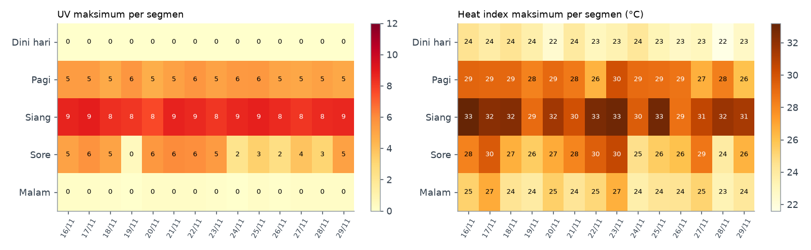

# ☀️ UV & Heat Index Bandung (ITB) — pantauan harian otomatis

Data **Open-Meteo** diambil otomatis tiap jam oleh GitHub Actions, dibagi per segmen waktu harian (WIB), lalu diterjemahkan menjadi **tindakan yang perlu dilakukan**, bukan sekadar angka.
Dasbor web: aktifkan GitHub Pages (Settings → Pages → Branch `main`, folder `/docs`).

## 📌 Hari ini

<!-- TODAY:START -->
_(akan terisi otomatis setelah workflow pertama berjalan)_
<!-- TODAY:END -->


<details><summary>Rincian per jam hari ini</summary>

<!-- HOURLY:START -->
<!-- HOURLY:END -->

</details>

## 📈 Perkembangan 14 hari terakhir



Riwayat per jam: [`data/hourly.csv`](data/hourly.csv) · Perubahan prakiraan hari ini sepanjang waktu: [`data/forecast_log.csv`](data/forecast_log.csv) · Ringkasan terbaru (JSON): [`data/today.json`](data/today.json)

## Cara baca
Kolom **Kepastian (kisaran)** menunjukkan seberapa sepakat beberapa model cuaca Open-Meteo (kisaran UV) dan galat input heat index (suhu ±1 °C, RH ±10%). Jika kisaran melintasi kategori yang lebih berat, tindakan memakai **skenario terburuk** (⚠️).

| Segmen | Jam (WIB) |
|---|---|
| Dini hari | 00:00–06:00 |
| Pagi | 06:00–10:00 |
| Siang | 10:00–15:00 |
| Sore | 15:00–18:00 |
| Malam | 18:00–24:00 |

- **UV**: skala WHO — 🟢 Rendah (<3) · 🟡 Sedang (3–5) · 🟠 Tinggi (6–7) · 🔴 Sangat tinggi (8–10) · 🟣 Ekstrem (≥11).
- **Heat index**: rumus NWS/NOAA (suhu + kelembapan), dalam °C — 🟢 <27 · 🟡 27–32 · 🟠 32–41 · 🔴 41–54 · 🟣 ≥54. Bandung berada di ±770 mdpl dan sejuk, sehingga heat index umumnya mendekati suhu udara dan jarang melewati ambang waspada; **UV adalah faktor risiko utama**.
- Perkiraan "menit sebelum kulit sensitif memerah" (≈ 200/UVI) hanya patokan kasar, bukan saran medis.
- Batas segmen bisa diubah di `SEGMEN` pada `uvheat/core.py`; koordinat di `LAT, LON`.

## Sumber, asumsi, dan ketidakpastian (ringkas)

- **Sumber:** Open-Meteo (Forecast & Historical Forecast API, CC BY 4.0); kategori UV WHO/WMO/UNEP/ICNIRP (2002); heat index NWS/NOAA (Rothfusz 1990, Steadman 1979).
- **Data adalah keluaran model, bukan sensor ITB** — iklim mikro kampus tidak tertangkap; belum divalidasi dengan alat ukur lokal.
- **Asumsi utama:** satu titik di ITB Ganesha; batas segmen adalah pilihan (hasil sensitif terhadapnya); heat index kondisi teduh; galat input suhu ±1 °C, RH ±10%; tindakan = pedoman umum, bukan nasihat medis.
- **Ketidakpastian:** variabilitas antarhari, selisih antar-model, galat input/rumus heat index, dan pilihan batas segmen — dihitung di notebook (bootstrap, antar-model, Monte Carlo, uji sensitivitas).
- Rincian lengkap: [`METODOLOGI.md`](METODOLOGI.md).

## Menjalankan sendiri

```bash
pip install -r requirements.txt
python scripts/update.py            # ambil data nyata & perbarui semua keluaran
python -m pytest -q tests           # tes unit
```

Notebook Colab penjelasan lengkap: `notebook/Bandung_UV_HeatIndex.ipynb`.

Data: [Open-Meteo.com](https://open-meteo.com/) (CC BY 4.0, non-komersial).
