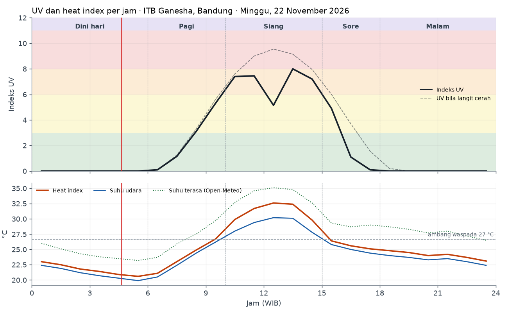

# UV dan Heat Index Bandung (ITB)

[](https://github.com/Skydragoncrazykiller/UVBANDUNG/actions/workflows/update.yml)
[](https://colab.research.google.com/github/Skydragoncrazykiller/UVBANDUNG/blob/main/notebook/Bandung_UV_HeatIndex.ipynb)

Pemantauan intensitas sinar UV dan heat index di kampus ITB Ganesha, Bandung, per segmen waktu dalam sehari. Data diambil dari Open-Meteo setiap jam melalui GitHub Actions, lalu diterjemahkan menjadi tindakan praktis untuk setiap segmen waktu.

**Dasbor:** <https://skydragoncrazykiller.github.io/UVBANDUNG/> · **Notebook analisis:** [`notebook/Bandung_UV_HeatIndex.ipynb`](notebook/Bandung_UV_HeatIndex.ipynb) · **Metodologi:** [`METODOLOGI.md`](METODOLOGI.md)

## Kondisi hari ini

<!-- TODAY:START -->
**Minggu, 22 November 2026** · ITB Ganesha, Bandung · diperbarui 04:38 WIB

| Ringkasan hari ini | |
|---|---|
| Puncak UV | **8,0** (Sangat tinggi) pukul 13:00 WIB |
| Jam perlu proteksi (UV ≥ 3) | 08:00–16:00 |
| Jendela UV aman (< 3) | 06:00–08:00, 16:00–18:00 |
| Heat index tertinggi | **32,6 °C** (Sangat waspada) |

| Segmen | Jam (WIB) | UV maks | Heat index maks | Kepastian | Tindakan |
|---|---|---|---|---|---|
| **Dini hari** (berlangsung) | 00:00–06:00 | Tidak ada | **23,0 °C** Aman | Tinggi · HI 22–24 °C | Tabir surya tidak diperlukan. |
| **Pagi** | 06:00–10:00 | **5,3** Sedang (09:00) | **26,7 °C** Waspada | Tinggi · UV 5,3–5,8 · HI 26–28 °C · CAMS 5,8 | SPF 30+ dan kacamata hitam; cari teduh saat terik. Bawa botol minum; minum sebelum haus. Mendung tidak mengurangi risiko UV. |
| **Siang** | 10:00–15:00 | **8,0** Sangat tinggi (13:00) | **32,6 °C** Sangat waspada | Sedang · UV 7,2–8,0 · HI 30–35 °C · CAMS 7,2 | Hindari luar ruang tanpa naungan; bila perlu SPF 50+, topi, pakaian menutup. Minum ±250 ml tiap jam secara perlahan; kurangi aktivitas berat. Mendung tidak mengurangi risiko UV. |
| **Sore** | 15:00–18:00 | **4,9** Sedang (15:00) | **26,4 °C** Aman | Sedang · UV 1,3–4,9 · HI 25–28 °C · CAMS 1,3 · skenario terburuk | SPF 30+ dan kacamata hitam; cari teduh saat terik. Bawa botol minum; minum sebelum haus. Mendung tidak mengurangi risiko UV. Bawa payung. |
| **Malam** | 18:00–24:00 | Tidak ada | **24,8 °C** Aman | Tinggi · HI 24–26 °C | Tabir surya tidak diperlukan. |

**Pesan hari ini untuk mahasiswa**

- UV hari ini mencapai 8,0 (sangat tinggi) sekitar pukul 13:00. Pakai sunscreen dan cari tempat teduh pada 08:00–16:00.
- Target minimal 8 gelas air putih sehari. Kalau kamu banyak di luar ruang, minum ±250 ml tiap jam secara perlahan. Cek warna pipis: kuning pucat berarti cukup.
- Kombo hari ini: minum cukup + sunscreen + berteduh di jam puncak.

<sub>Sumber: Open-Meteo. Angka adalah keluaran model, bukan pengukuran sensor di ITB; lihat [METODOLOGI.md](METODOLOGI.md) untuk asumsi dan ketidakpastian.</sub>
<!-- TODAY:END -->



<details>
<summary>Rincian per jam</summary>

<!-- HOURLY:START -->
| Jam | UV | Heat index (°C) | Suhu (°C) | RH (%) | Awan (%) |
|---:|---:|---:|---:|---:|---:|
| 05:00 | 0,0 | 20,6 | 19,9 | 100 | 100 |
| 06:00 | 0,1 | 21,1 | 20,5 | 97 | 100 |
| 07:00 | 1,1 | 23,0 | 22,4 | 87 | 98 |
| 08:00 | 3,1 | 24,9 | 24,4 | 76 | 83 |
| 09:00 | 5,3 | 26,7 | 26,2 | 70 | 85 |
| 10:00 | 7,4 | 29,9 | 28,0 | 64 | 84 |
| 11:00 | 7,5 | 31,7 | 29,4 | 60 | 98 |
| 12:00 | 5,2 | 32,6 | 30,2 | 57 | 97 |
| 13:00 | 8,0 | 32,4 | 30,1 | 57 | 47 |
| 14:00 | 7,2 | 29,8 | 27,8 | 66 | 96 |
| 15:00 | 4,9 | 26,4 | 25,8 | 76 | 56 |
| 16:00 | 1,1 | 25,6 | 25,0 | 80 | 92 |
| 17:00 | 0,1 | 25,1 | 24,4 | 85 | 85 |
| 18:00 | 0,0 | 24,8 | 24,0 | 88 | 80 |
<!-- HOURLY:END -->

</details>

## Tren 14 hari terakhir


## Cara membaca

Hari dibagi menjadi lima segmen (WIB). Untuk tiap segmen diambil nilai **maksimum** UV dan heat index, yaitu kondisi terburuk dalam segmen tersebut.

| Segmen | Jam |
|---|---|
| Dini hari | 00:00–06:00 |
| Pagi | 06:00–10:00 |
| Siang | 10:00–15:00 |
| Sore | 15:00–18:00 |
| Malam | 18:00–24:00 |

| Indeks UV (WHO) | Kategori | Heat index (NWS) | Kategori |
|---|---|---|---|
| < 3 | Rendah | < 27 °C (80 °F) | Aman |
| 3–5 | Sedang | 27–32 °C (80–90 °F) | Waspada |
| 6–7 | Tinggi | 32–39 °C (90–103 °F) | Sangat waspada |
| 8–10 | Sangat tinggi | 39–52 °C (103–125 °F) | Bahaya |
| ≥ 11 | Ekstrem | ≥ 52 °C (≥ 125 °F) | Sangat bahaya |

Ambang tepatnya adalah 26,7 / 32,2 / 39,4 / 51,7 °C (konversi dari °F). WHO menganjurkan perlindungan dari matahari saat UV ≥ 3, sehingga dasbor menampilkan "jam perlu proteksi" (UV ≥ 3) dan "jendela aman" (UV < 3).

Ringkasan harian juga memuat **pesan untuk mahasiswa** (UV, hidrasi, dan "kombo" minum cukup + sunscreen + berteduh) yang diselaraskan dengan materi poster Diseminasi Informasi Meteorologi.

Kolom **Kepastian** memakai pembanding UV independen (UV CAMS dan spread ensemble) serta galat input heat index; spread ensemble menunjukkan sebaran prakiraan, bukan galat terhadap pengamatan. Bila kisarannya melewati kategori yang lebih berat, tindakan mengikuti skenario terburuk.

Bandung berada di sekitar 770 mdpl dan relatif sejuk, sehingga heat index umumnya mendekati suhu udara; UV cenderung menjadi faktor risiko yang lebih menentukan.

## Sumber, asumsi, dan batasan

- Data adalah keluaran model numerik Open-Meteo, **bukan pengukuran sensor di ITB**, dan belum divalidasi dengan alat ukur lokal. Hasil bersifat indikatif.
- Satu titik lokasi (−6,8915; 107,6107); iklim mikro kampus tidak tertangkap.
- Batas segmen adalah pilihan analis; hasil sensitif terhadapnya (lihat analisis di notebook).
- Tindakan adalah pedoman umum, bukan nasihat medis. Estimasi waktu kulit memerah (sekitar 200/UVI menit) sangat kasar.
- Asumsi lengkap, sumber, dan metode ketidakpastian: [`METODOLOGI.md`](METODOLOGI.md).

## Struktur repositori

```
uvheat/core.py            pengambilan data, heat index, klasifikasi, rekomendasi, ketidakpastian
uvheat/render.py          keluaran Markdown, HTML, dan grafik
scripts/update.py         pembaruan data dan keluaran (dijalankan Actions tiap jam)
notebook/                 notebook Colab dan skrip pembangunnya
data/hourly.csv           riwayat per jam (UV, suhu, RH, awan, heat index)
data/forecast_log.csv     catatan perubahan prakiraan hari ini
data/uncertainty_log.csv  UV utama vs CAMS dan SD ensemble per jam (riwayat pembanding)
data/sumber_status.json   status pengambilan Ensemble Mean dan CAMS pada run terakhir
data/today.json           ringkasan terbaru (JSON)
docs/                     dasbor web (GitHub Pages) dan grafik
tests/                    tes unit
```

## Menjalankan secara lokal

```bash
pip install -r requirements.txt
python scripts/update.py      # ambil data dan perbarui semua keluaran
python -m pytest -q tests     # tes unit
```

Notebook dibangun ulang dari `uvheat/core.py` dengan `python notebook/build_notebook.py`.

## Data dan atribusi

Data cuaca: [Open-Meteo.com](https://open-meteo.com/) (CC BY 4.0, penggunaan non-komersial). Skala UV: WHO/WMO/UNEP/ICNIRP (2002). Heat index: US National Weather Service (Rothfusz, 1990).
